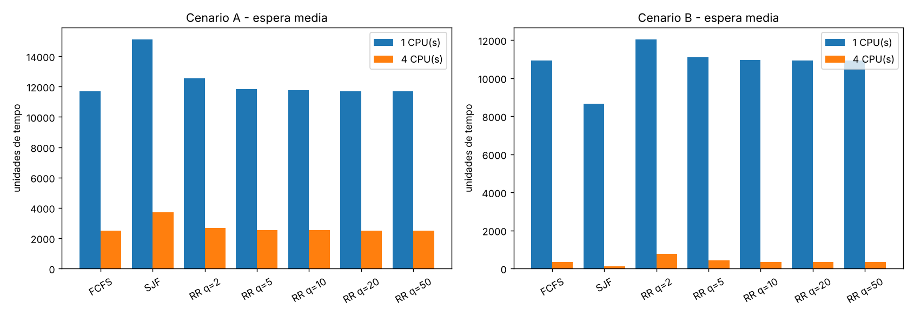
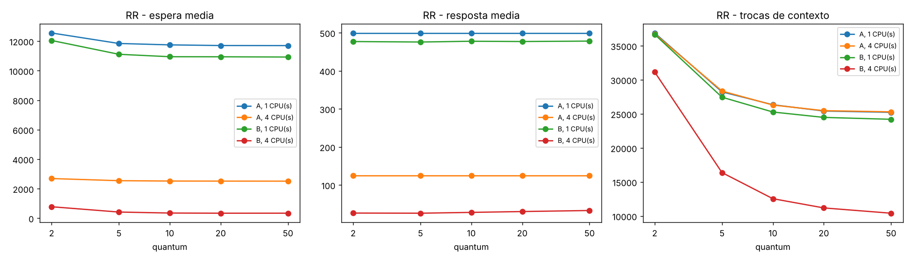
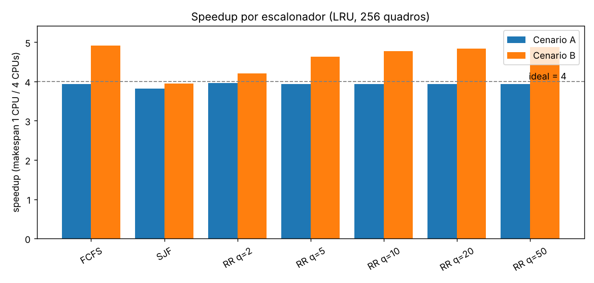
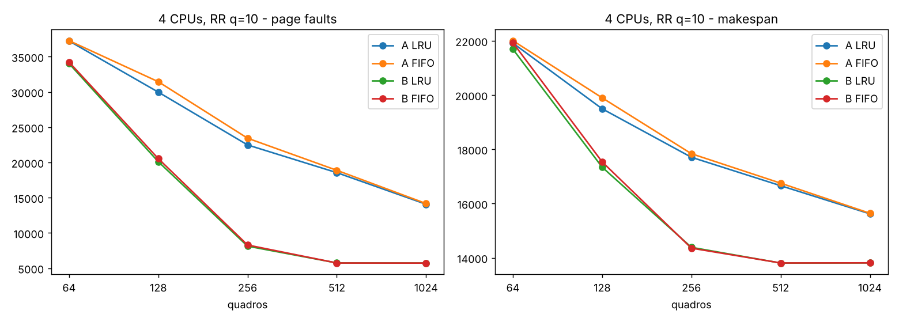
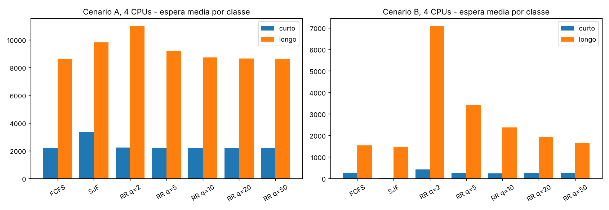
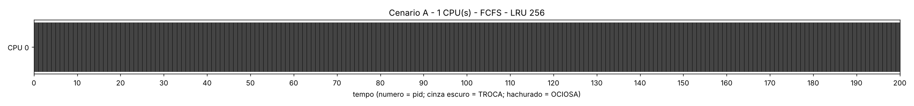
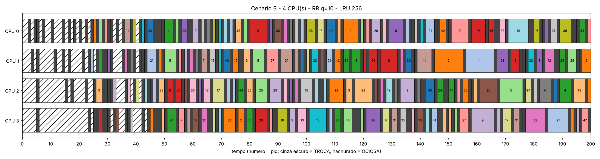
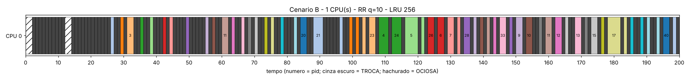

# Relatório M2 — Escalonamento multiprocessado com paginação sob demanda

Todos os números vêm de `resultados/tabelas.md` e `resultados/execucoes.csv`, gerados por
`make && python3 experimentos.py`. Uma execução é identificada como **cenário-CPUs-escalonador**; por exemplo,
`B-4-RR10` é o cenário B com 4 CPUs e RR de quantum 10. Quando nada for dito, a memória é LRU com 256
quadros, troca = 1 e fault = 20.

## 1. Validação do simulador

`make teste` roda os exemplos do enunciado no `./simulador` (em C) e compara com os valores esperados. Os 23 testes
passam:

| Exemplo | Conferido |
| --- | --- |
| 5.4 (P17 sem faults) | turnaround 19, espera 0 |
| 5.5 (P17 com faults) | 4 faults, término em 441, turnaround 99 |
| 7.1 FCFS | espera 0/6/8, resposta 0/6/8, turnaround 6/10/11, útil 10, troca 3, ocioso 0, makespan 13 |
| 7.1 SJF e RR q=2 (exercício) | SJF: espera 7/0/2. RR: término 16/14/9, espera 8/9/4, 6 trocas |
| 7.2 | espera 0/0/0, turnaround 12/12/6, makespan 13 |
| 7.3 | FCFS: espera 0/4/7. SJF: espera 5/2/0 |

O `--log` mostra, instante a instante, a fila de prontos, os bloqueados e os quadros. Ele serve para
provar cada regra na defesa. O log do exemplo 7.2 reproduz a tabela do enunciado linha por linha.

### Implementação e estruturas de dados

O simulador é em C (`simulador.c`) e lê o JSON com a biblioteca cJSON. O tempo avança em unidades
inteiras, e cada instante segue a ordem da seção 6.2: fim das unidades, chegadas e retornos em ordem
de pid, preempção por quantum e despachos.

- **Memória:** os quadros ficam numa lista duplamente ligada na ordem de substituição, e cada
  processo tem uma tabela `quadro[pag]`. O acerto é O(1). A vítima é o primeiro quadro não protegido
  a partir da cabeça da lista. No FIFO a ordem é a de carga; no LRU todo acerto move o quadro para o
  fim. Assim as duas políticas usam a mesma estrutura e diferem só em uma linha.
- **Fila de prontos:** vetor circular no FCFS e no RR, heap por `(restante do burst, ordem de
  entrada)` no SJF.
- **Bloqueados:** heap por instante de retorno, sem fila de disco.

Com essas estruturas cada execução do cenário completo leva menos de 1 s, e as 52 execuções levam
cerca de 25 s.

## 2. Desenho experimental

| Grupo | Execuções | Objetivo |
| --- | --- | --- |
| Base | A e B × 1 e 4 CPUs × {FCFS, SJF, RR q=2, 5, 10, 20, 50}, LRU, 256 quadros = **28** | comparar escalonadores e calcular o speedup |
| FIFO × LRU | A e B × 1 e 4 CPUs × {FCFS, RR10} com FIFO = **8** (comparadas às 8 equivalentes da base) | efeito da política de substituição |
| Quadros (opcional) | A e B × 4 CPUs × RR10 × {LRU, FIFO} × {64, 128, 256, 512, 1024} | thrashing e tamanho da memória |

O enunciado fala em "RR com 5 quantums" e lista 2, 10 e 50. Completamos com 5 e 20 para ter as 28
execuções. O modelo é determinístico: a mesma entrada sempre dá o mesmo resultado, então não há
variância a medir e uma execução por configuração basta.

**Carga.** Os dois cenários têm a mesma carga: 1000 processos (947 curtos e 53 longos), 43.249
unidades de CPU, 34.786 de E/S e 5.737 páginas distintas referenciadas. No B as chegadas vão até
t=11.373, o que dá 43.249 / 11.373 ≈ **3,8 unidades de CPU por unidade de tempo**: 95% de 4 CPUs, mas
**380% de 1 CPU**. Esse número explica boa parte da análise.

**Mínimo teórico de faults.** Cada página distinta precisa ser trazida pelo menos uma vez, então
nenhuma execução pode ter menos de **5.737 faults** (taxa ≈ 11,7%).

## 3. Resultados

Tabelas completas, inclusive a tabela por CPU de todas as execuções, estão em
[`resultados/tabelas.md`](resultados/tabelas.md). Resumo das execuções base:

### Cenário A (todos chegam em t=0)

| Execução | Espera méd | Espera máx | Turnaround | Resposta | Makespan | Speedup | Trocas | Faults | Taxa | Sem vítima |
|---|---|---|---|---|---|---|---|---|---|---|
| A-1-FCFS | 11700 | 61701 | 25691 | 499,5 | 68522 | 3,93 | 25228 | 22253 | 34,0% | 13483 |
| A-1-SJF | 15129 | 53618 | 15406 | 7587 | 54698 | 3,82 | 11256 | 8283 | 16,1% | 409 |
| A-1-RR2 | 12557 | 73213 | 26489 | 499,5 | 80245 | 3,96 | 36885 | 22117 | 33,8% | 13441 |
| A-1-RR10 | 11750 | 62701 | 25747 | 499,5 | 69732 | 3,94 | 26342 | 22535 | 34,3% | 13483 |
| A-1-RR50 | 11700 | 61701 | 25691 | 499,5 | 68522 | 3,93 | 25228 | 22253 | 34,0% | 13483 |
| A-4-FCFS | 2511 | 11811 | 6516 | 124,5 | 17435 | — | 25302 | 22330 | 34,1% | 8455 |
| A-4-SJF | 3716 | 13030 | 4004 | 1884 | 14302 | — | 12424 | 9454 | 17,9% | 173 |
| A-4-RR2 | 2687 | 14658 | 6689 | 124,5 | 20277 | — | 36753 | 22256 | 34,0% | 8675 |
| A-4-RR10 | 2519 | 11991 | 6528 | 124,5 | 17708 | — | 26299 | 22487 | 34,2% | 8455 |
| A-4-RR50 | 2511 | 11811 | 6516 | 124,5 | 17435 | — | 25302 | 22330 | 34,1% | 8455 |

### Cenário B (chegadas espalhadas)

| Execução | Espera méd | Espera máx | Turnaround | Resposta | Makespan | Speedup | Trocas | Faults | Taxa | Sem vítima |
|---|---|---|---|---|---|---|---|---|---|---|
| B-1-FCFS | 10926 | 60301 | 18886 | 478,2 | 67504 | 4,91 | 24204 | 21229 | 32,9% | 10929 |
| B-1-SJF | 8655 | 51356 | 8912 | 3618 | 53993 | 3,95 | 10565 | 7593 | 14,9% | 358 |
| B-1-RR2 | 12049 | 72473 | 20428 | 477,0 | 80021 | 4,21 | 36668 | 21467 | 33,2% | 11308 |
| B-1-RR10 | 10948 | 60959 | 18793 | 477,8 | 68658 | 4,77 | 25274 | 21466 | 33,2% | 10725 |
| B-1-RR50 | 10926 | 60301 | 18886 | 478,2 | 67498 | 4,88 | 24205 | 21229 | 32,9% | 10929 |
| B-4-FCFS | 335 | 3919 | 566 | 34,0 | 13737 | — | 10117 | 7144 | 14,2% | 0 |
| B-4-SJF | 115 | 5162 | 317 | 16,3 | 13681 | — | 8747 | 5778 | 11,8% | 0 |
| B-4-RR2 | 776 | 10747 | 1136 | 26,2 | 19022 | — | 31143 | 12556 | 22,5% | 0 |
| B-4-RR10 | 349 | 4828 | 602 | 28,0 | 14387 | — | 12542 | 8132 | 15,8% | 0 |
| B-4-RR50 | 339 | 3914 | 574 | 32,9 | 13829 | — | 10410 | 7336 | 14,5% | 0 |

As linhas RR5 e RR20 estão em `tabelas.md` e ficam entre as vizinhas.

### Tempo útil × troca (CPU 0)

| Execução | %útil | %troca | %ocioso |
|---|---|---|---|
| A-1-FCFS | 63,1% | 36,8% | 0,1% |
| A-1-SJF | 79,1% | 20,6% | 0,4% |
| A-1-RR2 | 53,9% | 46,0% | 0,1% |
| B-4-FCFS | 80,3% | 17,8% | 2,0% |
| B-4-SJF | 80,9% | 16,8% | 2,2% |
| B-4-RR2 | 57,6% | 41,0% | 1,5% |

### Gráficos

| | |
|---|---|
|  |  |
|  |  |

### Gantt (0 a 200)

Há um Gantt para cada uma das 28 execuções base em `resultados/gantt/` (PNG e CSV). Os dois pedidos:

**1 CPU — A-1-FCFS**

**4 CPUs — B-4-RR10**

Para comparar, com chegadas espalhadas e 1 CPU:

## 4. Análise crítica

### 4.1 Cenário A: a memória satura com páginas protegidas (thrashing)

O Gantt de A-1-FCFS de 0 a 200 é **só TROCA**. Todos os 1000 processos chegam em t=0 com a memória
vazia. Cada despacho custa 1 unidade de troca e a primeira referência dá fault. O processo bloqueia,
a CPU despacha o próximo e o ciclo se repete. Por isso a resposta média é **499,5**, a média de 0 a
999: cada processo é "atendido" em 1 unidade, mas sem fazer nada útil. A resposta parece ótima e não
significa nada aqui.

Depois do fault a página fica **protegida** até o processo voltar à CPU e repetir a referência. Só
que ele volta para o fim de uma fila de ~1000 processos. Com 256 quadros e 1000 processos esperando,
todos os quadros acabam protegidos e os faults seguintes não encontram vítima. Em A-1-FCFS foram
**13.483 faults sem vítima de 22.253** (61%). A taxa ficou em **34,0%**, três vezes o mínimo de 11,7%.
A CPU aparece 99,9% ocupada, mas só **63,1% é tempo útil** e 36,8% é troca. Isso é thrashing: o
sistema gasta o tempo trazendo páginas e trocando contexto em vez de executar.

A variação de quadros confirma a causa. Em A-4-RR10 ainda há 6.688 faults sem vítima com 512 quadros.
Eles somem só com **1024 quadros** (0 sem vítima), o primeiro valor acima do número de processos.
Uma página protegida por processo esperando é exatamente o que esgota a memória.

### 4.2 SJF: menor turnaround e menos faults, mas espera maior e injustiça

Em A-1, o SJF teve o menor makespan (54.698 contra 68.522 do FCFS), o menor turnaround (15.406
contra 25.691) e **2,7× menos faults** (8.283 contra 22.253, só 409 sem vítima). Ao mesmo tempo teve
a **maior espera média** (15.129 contra 11.700) e a maior resposta (7.587 contra 499,5).

Não há contradição. A espera, por definição (10.1), conta só o tempo na fila de prontos e exclui E/S
e page fault. No FCFS e no RR o processo passa boa parte da vida **bloqueado em fault**, um tempo que
não aparece na espera mas aparece no turnaround. O SJF leva até o fim os bursts curtos, que liberam a
CPU em poucas unidades. Assim há menos processos "pela metade" disputando quadros, e a memória
thrasheia menos. Num cenário com faults, **a espera média sozinha engana**. A métrica honesta para
comparar é o turnaround (e o makespan).

O preço é a injustiça (gráfico g5):

- B-4-SJF: espera média dos **curtos 38,4**, dos **longos 1.473,8**. A espera máxima, 5.162, é maior
  que a do FCFS (3.919), porque um processo com burst longo é ultrapassado por todo burst menor que
  chega.
- A-1-SJF: longos com espera média 41.400 contra 13.659 dos curtos.

Com chegadas contínuas e carga maior, isso vira **starvation**. No SJF não preemptivo não há
envelhecimento, e um burst longo só roda quando não há nenhum menor na fila.

### 4.3 FCFS: efeito comboio

O efeito comboio aparece nos curtos. Em B-4-FCFS eles esperam em média **267,7**, contra **38,4** no
SJF: ficam presos atrás de bursts longos (até 297 unidades) que ocupam as 4 CPUs. Na média geral o
FCFS ainda vai bem em B-4 (espera 335, turnaround 566), porque com carga de 95% a fila raramente
cresce. O comboio pesa mais nos curtos, que são 94,7% dos processos.

### 4.4 Efeito do quantum no RR

Gráfico g2 e execuções B-4-RR2 a RR50:

| Quantum | Trocas | %troca CPU0 | Faults | Makespan | Espera méd | Espera longos | Resposta |
|---|---|---|---|---|---|---|---|
| 2 | 31143 | 41,0% | 12556 | 19022 | 775,8 | 7082,9 | 26,2 |
| 10 | 12542 | 22,2% | 8132 | 14387 | 349,0 | 2378,1 | 28,0 |
| 50 | 10410 | 19,0% | 7336 | 13829 | 338,7 | 1652,3 | 32,9 |

- **Quantum pequeno** (q=2) multiplica as trocas por 3 e gasta 41% da CPU trocando contexto. O
  makespan cresce 37% em relação a q=50. Além disso, mais processos se alternam na CPU e disputam os
  quadros, e os faults sobem de 7.336 para 12.556. É a mesma interação escalonamento × memória da
  seção 4.1. Os longos são os mais prejudicados: com q=2 eles voltam à fila a cada 2 unidades
  (espera 7.083).
- **A resposta média** é a única métrica que melhora com quantum menor (26,2 contra 32,9). É a
  vantagem clássica do RR para interatividade, mas aqui o ganho é pequeno diante do custo.
- **Quantum grande** (q=50) se aproxima do FCFS. Em A-1, RR50 e FCFS dão resultados **idênticos**
  (makespan 68.522): com thrashing, todo processo sofre fault antes de completar 50 unidades seguidas,
  o fault interrompe o quantum e ele nunca expira.

### 4.5 Speedup: perto do ideal em A e superlinear em B

| | FCFS | SJF | RR2 | RR10 | RR50 |
|---|---|---|---|---|---|
| A | 3,93 | 3,82 | 3,96 | 3,94 | 3,93 |
| B | **4,91** | 3,95 | 4,21 | 4,77 | 4,88 |

- No **A** o speedup fica perto de 4 (eficiência 0,96 a 0,99). Com 1 ou com 4 CPUs a fila tem os
  mesmos 1000 processos e a memória thrasheia igual (taxa 34% nas duas), então o trabalho total é
  praticamente o mesmo e se divide por 4.
- No **B** o speedup **passa de 4** (B-FCFS: 4,91, eficiência 1,23). Não são 4 CPUs rendendo mais que
  4: são duas cargas de trabalho diferentes. Com 1 CPU a carga é de 380%, a fila cresce até virar o
  cenário A (10.929 faults sem vítima, 21.229 faults no total). Com 4 CPUs a carga é de 95%, a fila
  fica curta e não há fault sem vítima (7.144 faults). Mais CPUs esvaziam a fila, e isso **reduz a
  pressão sobre a memória**. É o ponto central do trabalho: escalonamento e memória não são
  independentes.
- O **SJF** tem o speedup mais baixo nos dois cenários (3,82 e 3,95). Ele já thrasheia pouco com 1
  CPU (7.593 faults em B-1), então não há esse ganho "extra" a recuperar com mais CPUs.

### 4.6 FIFO × LRU

| Execução | Faults LRU | Faults FIFO | Diferença |
|---|---|---|---|
| A-1-FCFS | 22253 | 23875 | +7,3% |
| B-1-FCFS | 21229 | 23102 | +8,8% |
| B-1-RR10 | 21466 | 22577 | +5,2% |
| B-4-FCFS | 7144 | 7217 | +1,0% |
| B-4-RR10 | 8132 | 8294 | +2,0% |

O LRU teve menos faults nas 8 configurações. As referências têm localidade (por exemplo,
`[1, 1, 5, 1, 0, 0, 1, 1, 5, 5]`) e o LRU mantém as páginas usadas há pouco, enquanto o FIFO pode
expulsar uma página muito usada só porque ela chegou cedo. A diferença é grande quando a memória está
sob pressão (5 a 9% nos casos de 1 CPU) e pequena quando sobra memória (1 a 2% em B-4). Nesse caso a
maioria dos faults é compulsória: são as 5.737 primeiras cargas, que nenhuma política evita.

No makespan a diferença fica abaixo de 3%. Em B-4 o FIFO teve até espera média um pouco **menor**
(325,0 contra 349,0 em RR10): mais faults deixam os processos mais tempo bloqueados e menos tempo na
fila. É o mesmo artefato da métrica de espera da seção 4.2.

### 4.7 Tamanho da memória

B-4-RR10 (gráfico g4):

| Quadros | Faults | Taxa | Sem vítima | Makespan | Util. |
|---|---|---|---|---|---|
| 64 | 34032 | 44,0% | 6307 | 21693 | 92,5% |
| 128 | 20108 | 31,7% | 0 | 17343 | 96,4% |
| 256 | 8132 | 15,8% | 0 | 14387 | 96,9% |
| 512 | 5751 | 11,7% | 0 | 13808 | 98,0% |
| 1024 | 5737 | 11,7% | 0 | 13815 | 97,9% |

Com 512 quadros os faults (5.751) já estão praticamente no mínimo compulsório (5.737). Daí em diante
memória extra não ajuda, e o conjunto de trabalho de todos os processos ativos cabe na memória. Com
64 quadros há thrashing: o makespan sobe 51% em relação a 256 e aparecem faults sem vítima.

### 4.8 Síntese

| Afirmação | Execução e métrica que a sustentam |
|---|---|
| Em carga alta a memória satura com páginas protegidas e há thrashing | A-1-FCFS: 13.483 faults sem vítima, taxa 34%, 36,8% da CPU em troca |
| SJF tem o melhor turnaround e o menor makespan | A-1-SJF: turnaround 15.406 contra 25.691 (FCFS); makespan 54.698 contra 68.522 |
| Espera média engana quando há faults | A-1-SJF: espera 15.129 > FCFS 11.700, mas turnaround 40% menor |
| SJF é injusto com processos longos | B-4-SJF: espera curtos 38,4 contra longos 1.473,8; máx 5.162 > FCFS 3.919 |
| FCFS tem efeito comboio | B-4-FCFS: curtos esperam 267,7 contra 38,4 no SJF |
| Quantum pequeno desperdiça CPU em trocas | B-4-RR2: 41% troca, makespan 19.022 contra 13.829 (q=50) |
| Mais CPUs aliviam a memória (speedup superlinear) | B-FCFS: speedup 4,91; faults 21.229 (1 CPU) contra 7.144 (4 CPUs) |
| LRU ≤ FIFO em faults | 8 de 8 configurações; até 8,8% menos (B-1-FCFS) |
| Acima de ~512 quadros não há ganho | B-4-RR10: 5.751 faults com 512 quadros contra 5.737 de mínimo |

## 5. Interpretações adotadas

- **Fault sem vítima:** o processo fica bloqueado por `custo-fault` e tenta de novo. Quando consegue um
  quadro, a página é carregada (mais `custo-fault`) e o fault **não** é contado outra vez.
- **Taxa de faults** = faults ÷ (faults + acertos). Os acertos somam 43.249, uma referência por
  unidade de CPU.
- **Trocas de contexto** são contadas sempre que a CPU despacha um processo diferente do último que
  ela executou. Com `--custo-troca 0` a contagem continua, mas sem custo.
- **Utilização** = (útil + troca) ÷ makespan, como em 10.1. A tabela por CPU separa as três parcelas,
  e útil + troca + ocioso = makespan em todas as execuções.
- **Página carregada** conta como referenciada no instante da carga, para o LRU. Enquanto está
  protegida ela não pode ser vítima.
- **Gantt:** trocas seguidas para processos diferentes aparecem como intervalos separados.

## 6. Limitações do modelo

- **SJF com burst conhecido:** o SJF usa o valor exato do campo `cpu`. Um SO real não sabe esse
  valor e precisaria estimá-lo, por exemplo com média exponencial dos bursts anteriores. Com uma
  estimativa, o resultado do SJF ficaria pior que o mostrado aqui.
- **Sem fila de disco:** os faults e as E/S correm em paralelo, sem limite. Em A, centenas de faults
  de 20 unidades acontecem ao mesmo tempo, o que um disco real não faria. Os tempos de fault estão
  subestimados quando há muitos simultâneos.
- **Proteção de página:** a página do fault fica protegida até o processo voltar à CPU. Isso não
  existe nessa forma em um SO real e é a causa direta do "sem vítima" no cenário A.
- **Substituição global e sem conjunto de trabalho:** um SO real detectaria o thrashing e suspenderia
  processos (swap), algo que o modelo não faz.
- **Custos fixos:** troca e fault têm custo constante e inteiro. Não há TLB, cache nem diferença de
  custo entre página suja e limpa.
- **Tempo discreto e uma só carga:** os resultados valem para essa seed. O modelo é determinístico,
  então não há intervalo de confiança. Outras seeds poderiam mudar a magnitude, mas as tendências
  (SJF × longos, thrashing com fila longa, custo do quantum pequeno) vêm do mecanismo e não da carga.
